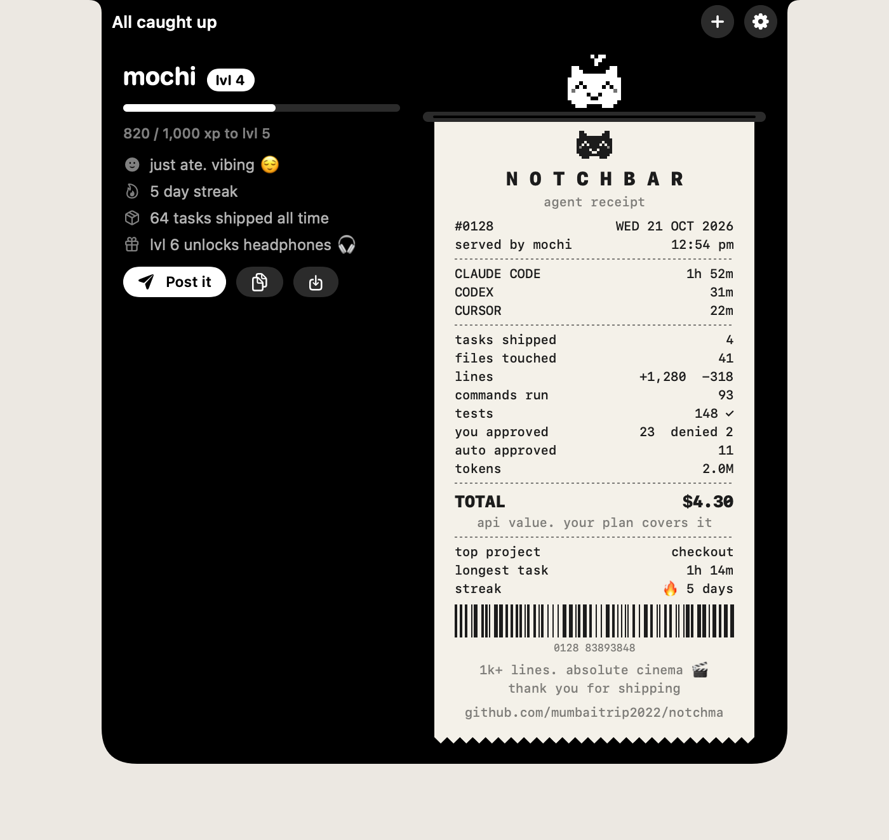
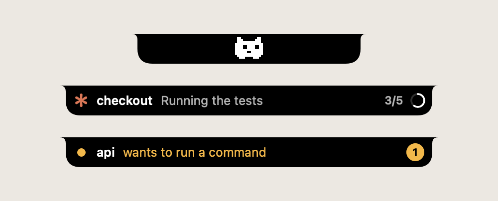
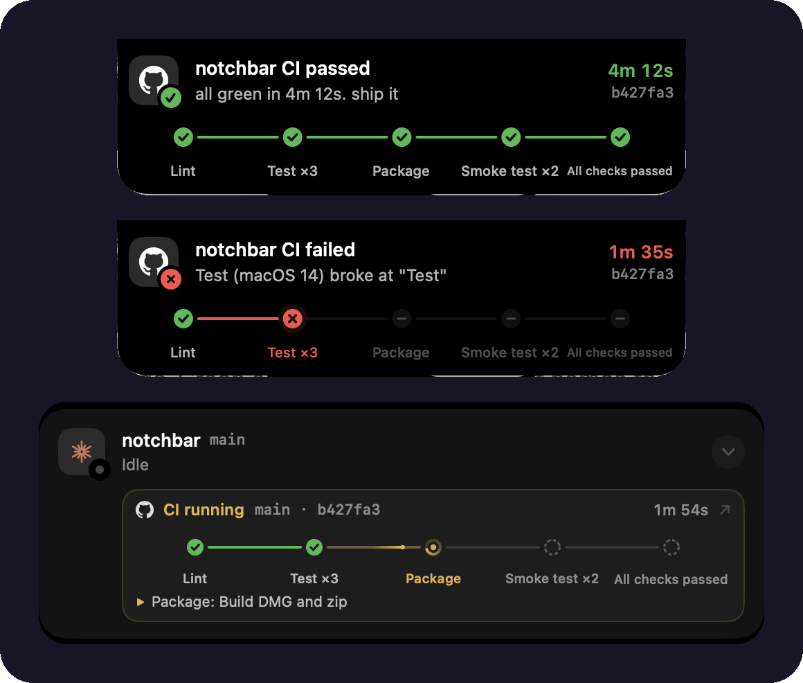
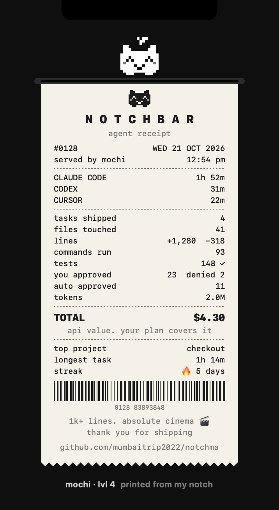

<div align="center">

# NotchBar

### Dynamic Island for AI coding agents on Mac

**Approve Claude Code, Codex and Cursor requests from your notch.** See what every agent is doing, track usage limits, and meet a pixel pet that prints a receipt of your day. 🏝️🧾

[](https://mumbaitrip2022.github.io/notchma/)

[](https://github.com/mumbaitrip2022/notchma/actions/workflows/ci.yml)
[](https://github.com/mumbaitrip2022/notchma/releases/latest)
[](https://github.com/mumbaitrip2022/notchma/releases)
[](https://github.com/mumbaitrip2022/notchma/stargazers)
[](LICENSE)




</div>

NotchBar turns the top of your Mac screen into a control center for coding agents. It works on every Mac: on MacBooks with a notch it wraps around the camera like the iPhone's Dynamic Island, and on other screens it draws its own island.

- ✅ **Approve or deny agent requests from the notch.** Claude Code, Codex and Cursor ask, you answer with one click or `⌃⌥Y`, from any app.
- 👀 **Live status for every session.** What each agent is doing right now, its plan, tests and files edited.
- 🚦 **GitHub Actions in the notch.** When an agent pushes, watch the CI pipeline live and get tapped the second it goes green or breaks, with the job and step that failed.
- 📊 **Usage limits and cost.** Claude's 5 hour and weekly limits, Codex windows, context fill, and a forecast of when you'll hit the limit.
- 🐾 **A notch pet and a daily receipt.** Share what your agents shipped today as a receipt image.
- 🪶 **Native and light.** Swift, SwiftUI and AppKit. About 20 MB of memory and close to 0% CPU when idle. No Electron, no account, no telemetry.
- 🎁 **Updates in one tap.** When a new version is out, your pet shows up with a gift. One click downloads it, checks it and restarts.

<div align="center">

</div>

## Contents

[Install](#install) · [Agents](#agents) · [GitHub Actions](#github-actions) · [Notch pet and daily receipt](#notch-pet-and-daily-receipt) · [Usage and cost](#usage-and-cost) · [Smart approvals](#smart-approvals-and-health) · [Flow features](#flow-features) · [How it works](#how-it-works) · [FAQ](#faq)

## Install

**Requirements:** a Mac with Apple silicon (M1 or newer) on macOS 14 Sonoma or later. Intel Macs aren't supported.

### Download
1. Get the latest **[NotchBar.dmg](https://github.com/mumbaitrip2022/notchma/releases/latest/download/NotchBar.dmg)** (or visit the [download page](https://mumbaitrip2022.github.io/notchma/)), open it and drag **NotchBar** into **Applications**.
2. Open NotchBar. If it starts from somewhere else, it offers to move itself to Applications. Say yes, since agents connect to it by path.
3. A short tour hosted by your pet opens in the notch and connects your agents. Or click **Connect** in the island. NotchBar adds its hooks to whichever of Claude Code, Codex and Cursor you have. Your other settings stay untouched, and a backup is kept next to each file. Codex wants new hooks trusted before it runs them, so NotchBar trusts its own entries for you (only those).
4. Optional, in Settings: launch at login, Accessibility (paste drafts, raise Warp windows), Calendar, Voice.

> NotchBar isn't notarized yet, so macOS says it "can't be opened" the first time. Open **System Settings › Privacy & Security**, scroll down and click **Open Anyway**.
> Or in Terminal: `xattr -dr com.apple.quarantine /Applications/NotchBar.app`

### Build from source
```sh
git clone https://github.com/mumbaitrip2022/notchma.git && cd notchma
make install     # builds, copies to ~/Applications, connects hooks, launches
```
Needs Xcode 16+ (Swift 6). Apps you build yourself never trigger Gatekeeper warnings.

## Agents

| Agent | Live status | Approvals in the notch | Config written |
|---|---|---|---|
| Claude Code | ✓ | ✓ (only when Claude would ask) | `~/.claude/settings.json` |
| Codex | ✓ | ✓ (only when Codex would ask) | `~/.codex/hooks.json` |
| Cursor | ✓ | opt in: Settings › *Approve Cursor commands in the notch* | `~/.cursor/hooks.json` |

- **Codex** only runs hooks you trust. NotchBar trusts its own entries for you through Codex's app server (the same thing `/hooks` does), and nothing else. If Codex isn't found, run `/hooks` in Codex once instead.
- **Cursor** calls hooks for *every* shell and MCP command, not just the ones it would ask about, so notch approvals are off by default. Turned on, each command waits for you in the notch.

## GitHub Actions

<div align="center">

</div>

The moment an agent runs `git push`, NotchBar finds the commit on GitHub and plays its pipeline in the notch.

- **Live pipeline.** Every stage of the workflow, in order, from the first second (read from your `.github/workflows` file). Matrix jobs fold into one stage (`Test 2/3`), and the step that's running shows underneath (`Package: Build DMG and zip`).
- **Passed:** a banner with the GitHub mark lights the stages up one by one, then says `all green in 4m 12s. ship it`.
- **Failed:** you hear about it the second a job breaks, not when the slowest one ends. The banner names the job and the step (`Test (macOS 14) broke at "Test"`), the broken stage shakes, and a tap opens that run on GitHub.
- **Closed notch glimpse:** while CI runs and no agent needs you, the closed notch shows the GitHub mark, the project, a mini pipeline and a ticking timer, so you can watch without opening anything.
- **CI card:** the expanded notch keeps a card under the session with the pipeline, branch, commit and timer, for 15 minutes after it finishes.
- Slow extras like CodeQL scans and Pages deploys never hold up the result. Pushes from a subfolder of the repo work too.

### Set it up

1. **Public repo:** nothing to do. The next push shows up in the notch.
2. **Private repo:** Settings › GitHub › **Connect GitHub**. Terminal opens, installs the [GitHub CLI](https://cli.github.com) with Homebrew if you don't have it, and signs you in through your browser with a one time code. NotchBar notices the login by itself in a few seconds. If you push to a private repo before connecting, a banner offers the same button.
3. **Already use `gh`?** You're connected already. Settings shows `Connected as @you`.

NotchBar borrows your `gh` login and never stores a token. It sends GitHub only the repo name and commit, uses conditional requests so polling barely touches your rate limit, and stops watching after 90 minutes. Turn it off in Settings › GitHub.

## Notch pet and daily receipt



When nothing is running, a tiny pixel pet lives in the notch. It wanders, blinks, naps when things are quiet, and eats a cookie every time one of your agents finishes a task.

- **Your pet sits in the notch header.** Click it any time, even while agents are busy, and it prints today's receipt. A scrap of paper sticks out when there's something new, and once an evening after a real day of work it tells you your receipt is ready (also in the gear menu: *Today's Receipt*).
- **Hover while idle** and today's receipt prints out of the notch line by line: time per agent, tasks shipped, files touched, lines, commands, tests, approvals, tokens and the API value of the day. Every number comes from your agents' real activity.
- **Post it** copies the receipt as an image and opens a post on X (press ⌘V to add the image). You can also copy it or save it to your Desktop.
- **Levels:** the pet hatches from an egg on your first finished task and levels up as you ship. Level 3 unlocks a sprout, level 6 headphones, level 10 a crown, and a 7 day streak gets it sunglasses.
- **Cheap:** it animates at a few frames per second only while visible and stops when your displays sleep. Turn it off or rename it in Settings.

<br clear="right">

## Usage and cost

- **Plan limits:** rings under the header show Claude's 5 hour and weekly limits and Codex's windows, with reset times. The island warns once at 80% and again at 95%.
- **Task receipt:** when a task finishes, the banner and the session row show `time · tokens · ≈$cost · +lines −lines`. The `≈$` figure is the **API equivalent** value of the work. On a Pro or Max plan it isn't billed.
- **Context meter:** a thin bar on each session shows how full its context window is (amber at 70%, red at 90%).
- **System vitals:** CPU (and how much of it your agents use), memory and free disk, sampled only while the notch is open.
- Claude data comes from a statusline NotchBar installs (it also prints `Opus 5.5 · ctx 42% · 5h 35% · week 6%` in your terminal). If you already have a statusline, NotchBar leaves it alone and skips Claude limits and cost.
- Codex data is read from its own session logs. Cursor doesn't expose usage, so it shows status only.

## Smart approvals and health

- **Always allow:** after you approve the same simple command twice in a project (like `npm test`), the third request offers **Always allow** (`⌃⌥A`).
  - Claude Code: saved as a native rule in that project's `.claude/settings.local.json`, so it works even without NotchBar.
  - Codex and Cursor: NotchBar answers matching requests instantly (about 45 ms).
  - Never offered for chained or piped commands (`&&`, `|`, `;`), interpreters (`python`, `node`, `sh`), or anything flagged destructive.
  - Review or remove rules in Settings.
- **Stuck detection:** a working agent with no events and no log growth for 6 minutes (15 while a command runs) gets an amber "may be stuck".
- **Loop detection:** the same call 4 times in 10 minutes, or the same command failing 3 times in a row, gets flagged. Flagged sessions float to the top.

## Flow features

**Keep agents busy**
- **Attention queue:** the header shows "3 waiting on you · oldest 12m". `⌃⌥J` (anywhere) jumps to the next one. Approvals open the notch, everything else jumps to its terminal.
- **Trust window:** on any approval card, *Trust project for 20m* (`⌃⌥T`) auto allows non destructive commands, in-project edits, reads and web lookups in that project until it ends. MCP, unknown tools and destructive commands still ask.
- **Read-only defaults** (Settings, off by default): `git status/diff/log`, `ls`, `cat`, `grep` with no pipes or redirects are allowed everywhere.
- **Allow all:** when one agent queues several safe requests, clear them in one click.

**Switch less**
- **Final answer in the notch:** unfold a session to read the agent's last message, test result and files edited.
- **Smarter done:** "Done · tests ✓ 24 passed · 3 files", parsed from jest, vitest, pytest, XCTest, swift-testing, cargo, go, rspec, mocha, phpunit and dotnet output.
- **Open diff and copy summary:** uncommitted changes (including new files) open as a `.diff` in Cursor or VS Code, and the summary is a ready commit message.
- **Exact jump:** tmux pane, iTerm2 or Terminal tab, or the right Cursor or VS Code window. Warp and Ghostty have no tab API, so NotchBar raises the window whose title matches the project (needs Accessibility).
- **Draft or queue the next prompt:** type it while the agent works. Queue it and the agent picks it up the moment it finishes, or keep it as a draft and send it with one tap. NotchBar never presses Return for you.

**Run in parallel**
- **New task (+):** pick a project, agent and prompt, optionally in its own **git worktree** on a new branch. Start now or **at the next limit reset**. Opens in Warp, iTerm2 or Terminal.
- **Conflict alert:** "Two agents are editing cart.ts" the moment two live sessions touch the same file.

**Use your plan well**
- **Limit forecast:** "full ~4:10 PM at this pace", plus a hint when another agent has room.
- **Use it or lose it:** a nudge when lots of a window is unused and it resets within 45 minutes.
- **Context nudge:** at 85% context, a tap copies `/compact` and jumps to the session.

**Fit your day** (opt in, Settings)
- **Meeting awareness:** warns about waiting agents 10 minutes before a calendar event. During it only approvals and urgent alerts show, then one digest afterwards.
- **Voice:** `⌃⌥V` to dictate your next prompt (on-device recognition when supported).

All shortcuts are ⌃⌥ and only registered while useful: `Y` allow · `N` deny · `A` always · `T` trust · `J` next · `V` voice.

## Use

| | |
|---|---|
| **Hover** the notch | Expand to see all sessions (or the pet and receipt when idle) |
| **Click** the notch | Pin it open |
| **Click a session** | Jump to its terminal (Warp, Cursor, iTerm, Terminal, Ghostty) |
| Permission request | The island opens with a chime and shows the command or diff |
| `⌃⌥Y` / `⌃⌥N` | Allow or deny from **any app**, only while a request is waiting |
| `⌘↩` / `⌘⌫` / `esc` | Allow, deny or hand back (while hovering the card) |
| Two agents busy | A second bubble splits off the island, like the iPhone |
| Turn finished | The island briefly shows a "done" banner |

Collapsed states: agent icon and spinner = working · amber dot = needs approval · red dot = destructive command · green check = finished · blue dot = waiting for you · pixel pet = all quiet.

## How it works

```
agent ──hook JSON──▶ notchbar-hook ──unix socket──▶ NotchBar.app
                         ▲                              │
                         └────── allow / deny ──────────┘
```

- NotchBar adds hook entries (`PermissionRequest`, `PreToolUse`, `PostToolUse`, `UserPromptSubmit`, `Stop`, `Notification`, `SessionStart`, `SessionEnd`) to each agent's config. Your other settings are untouched, and the original is saved as a `.notchbar-backup` file.
- **Fail safe:** if NotchBar isn't running, crashes, or you don't answer within about 10 minutes, the hook exits quietly and the agent shows its normal prompt. Nothing can get stuck.
- `AskUserQuestion` and plan approvals always stay in the terminal.
- The socket lives at `~/Library/Application Support/NotchBar/nb.sock` and only you can read it (mode 0600).
- Everything stays on your Mac. No account, no analytics. NotchBar talks to GitHub for two things only: a daily check for a new version, and, after an agent pushes, the Actions status of that commit. Both can be turned off in Settings.

## FAQ

**How do I approve Claude Code permission prompts without switching to the terminal?**
Install NotchBar and click Connect. When Claude Code asks for permission, the notch opens with the exact command or diff, and you click Allow or press `⌃⌥Y` from any app.

**Does it work on Macs without a notch, or on an external monitor?**
Yes. On screens without a notch it draws its own island at the top center, and it can follow whichever screen you're using.

**Does it work with Codex and Cursor too?**
Yes. Claude Code, OpenAI Codex and Cursor all show live status. Claude Code and Codex approvals work out of the box, and Cursor approvals are opt in.

**Can I see my Claude Code usage limits?**
Yes. The 5 hour and weekly limits show as rings with reset times, plus a forecast of when you'll hit them at your current pace.

**Is it free? Does it send my code anywhere?**
It's free and open source (MIT). It never sends your code or activity anywhere. It asks GitHub for updates once a day and, after an agent pushes, for that commit's CI status (only the repo name and commit). You can turn both off.

**Does it show GitHub Actions?**
Yes. When an agent pushes, the notch shows the pipeline live and taps you when it passes or fails, naming the job and step that broke. Public repos need no setup. For private repos, click Settings › GitHub › Connect GitHub once.

**How do I update?**
NotchBar checks once a day. When there's a new version, a banner shows what's new and *Update and restart* installs it in a few seconds. You can also use *Check for Updates…* in the gear menu. Every update is checked against GitHub's checksum and its code signature first.

**What is the notch pet?**
A tiny pixel pet that lives in the notch while your agents are idle. It levels up as you ship, and hovering prints a shareable receipt of your day.

**Something broke. How do I report it?**
Gear menu › *Report a Problem…* opens a page in the notch. Describe what happened, and NotchBar adds your Mac and app details and a short activity log (event names and timings only, never prompts, commands, code or paths). You can read every word before anything is shared, then it opens a ready-to-submit GitHub issue. If NotchBar ever crashes, it offers this on the next launch with the crash details attached.

**What happens if NotchBar quits?**
Your agents fall back to their normal prompts. Every hook checks that the app exists first.

## Uninstall

Settings › **Uninstall NotchBar…** removes only NotchBar's entries from the agents' settings and moves the app to the Trash. From source: `make uninstall`.

If the app is ever deleted without uninstalling, nothing breaks: each hook checks the app exists first, and the agents fall back to their own prompts.

## Develop

```sh
make run         # build and launch from ./build
swift test       # unit and integration tests (parsers, safety rules, git, pet, receipt)
swift build      # debug build (includes test-only socket commands)
make dist        # Apple silicon DMG and zip in ./dist
```

## Contributing

Issues and pull requests are welcome. Start with [CONTRIBUTING.md](CONTRIBUTING.md), and report security problems privately as described in [SECURITY.md](SECURITY.md). If NotchBar saves you a few context switches a day, a ⭐ helps other people find it.

## License

MIT. See [LICENSE](LICENSE).

<sub>Keywords: Claude Code GUI, Claude Code notifications, Claude Code permission approval, Codex CLI hooks, Cursor agent hooks, AI coding agent monitor, macOS notch app, Dynamic Island for Mac, menu bar app for developers, vibe coding tools.</sub>
